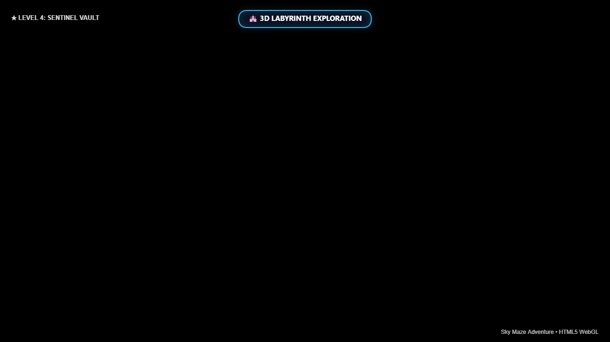
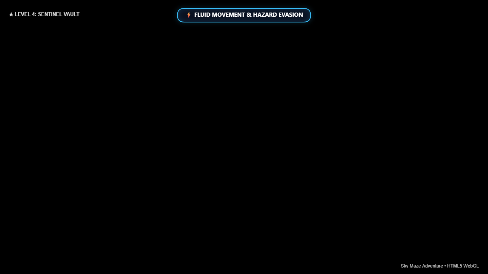
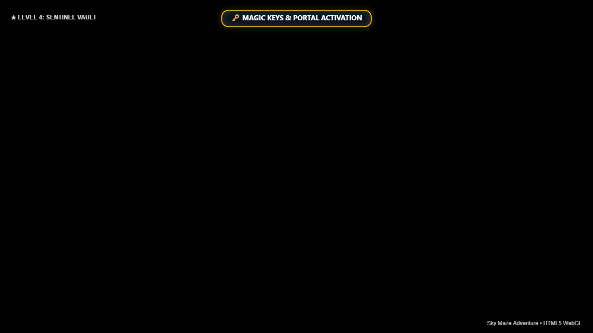
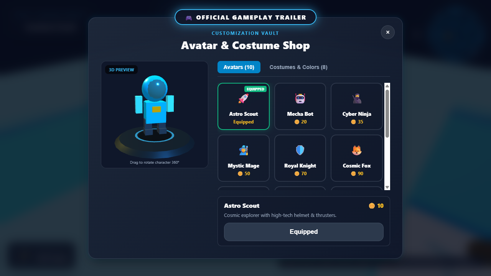
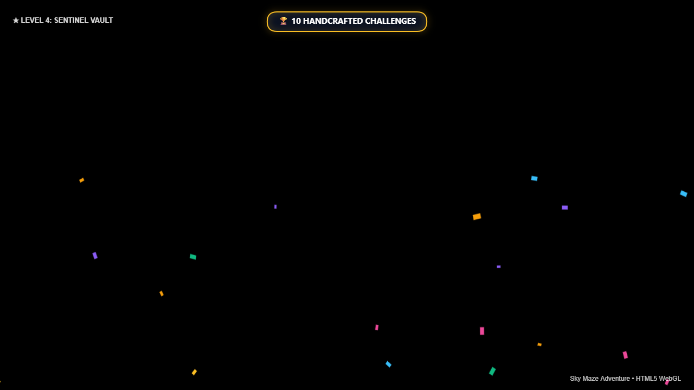

# 🏰 Sky Maze Adventure (3D Labyrinth Quest)

A polished, single-player 3D maze adventure game built with Three.js and the Web Audio API. Explore intricate labyrinths, dodge hazards, find magic keys, collect persistent gold coins, unlock new avatars and costumes in the shop, and reach the exit portal to conquer each level.

🌐 **Play Online directly in your browser**: [https://banothdavidnaik-boop.github.io/skymazeadventure1/](https://banothdavidnaik-boop.github.io/skymazeadventure1/)

---

## 🎬 Gameplay Trailer & Screenshots

🎬 **Official Trailer Video**: [trailer.mp4](trailer.mp4) (H.264 60/30fps HD) | [trailer.webm](trailer.webm)

| 3D Labyrinth Exploration | Fluid Movement & Hazard Dodge |
| :---: | :---: |
|  |  |

| Magic Key & Portal Ignition | 3D Avatar Customizer & Vault |
| :---: | :---: |
|  |  |

| 3-Star Level Victory Celebration |
| :---: |
|  |

---

## 🎮 How to Play

### Launching the Game
- Simply double-click **`play.bat`** or double-click **`index.html`** in any web browser (Chrome, Edge, Firefox, Brave, Safari).
- **100% Offline & Self-Contained**: Three.js is bundled locally in `lib/three.min.js`, and all music and sound effects are generated procedural Web Audio synthesizers (zero external assets or downloads required).

---

## 🕹️ Controls

| Action | Keyboard / Mouse | Mobile / Touch |
| :--- | :--- | :--- |
| **Move** | <kbd>W</kbd> Forward <kbd>S</kbd> Backward <kbd>A</kbd> Left <kbd>D</kbd> Right | Virtual Analog Joystick (left thumb) |
| **Jump** | <kbd>Spacebar</kbd> | Tap the **JUMP** button |
| **Sprint** | Hold <kbd>Shift</kbd> | Automatic / joystick outer range |
| **Rotate View Left** | <kbd>Q</kbd> (Tap or Hold) or Drag Left | Swipe upper screen area |
| **Rotate View Right** | <kbd>E</kbd> (Tap or Hold) or Drag Right | Swipe upper screen area |
| **Look Around** | Mouse Drag / Touchpad Drag / 2-Finger Swipe | Touch Drag on screen |
| **Pause / Settings** | <kbd>Escape</kbd> or <kbd>P</kbd> | Tap **⏸️** button on HUD |
| **Quick Restart** | <kbd>R</kbd> | Tap **🔄** button on HUD |
| **Shop** | Tap **🛍️** button | Tap **🛍️** button |

---

## 🌟 Game Features

### 1. Gameplay & Progression
- **Keys & Portals**: Every level requires finding and collecting the floating **Magic Key** to deactivate the laser barrier and ignite the swirling exit portal.
- **Persistent Gold Coins**: Scattered throughout the mazes in corridors and secret dead-ends. Coins are automatically banked and persist between levels and sessions via `localStorage`.
- **Progressive Levels**:
  - **Level 1 — Greenhorn Garden (8x8)**: Introduction to movement, camera, jumping, key pickup, and exit portal.
  - **Level 2 — Azure Corridors (11x11)**: Longer maze, introduces floor spike traps with timing windows.
  - **Level 3 — Sunlit Sanctum (13x13)**: Fire jet floor hazards that erupt in rhythmic pulses.
  - **Level 4 — Sentinel Vault (15x15)**: Patrolling sentry drones with searchlight cones + midway checkpoint crystal.
  - **Level 5 — The Royal Citadel (17x17)**: Grand master maze combining all hazards with hidden coin caches.
  - **Level 6 — Crystal Caverns (17x17)**: Deep shrines with glowing crystal checkpoints and timed spike gauntlets.
  - **Level 7 — Inferno Chamber (19x19)**: Intensive flame geysers blocking key junctions with coin alcoves.
  - **Level 8 — Clockwork Maze (19x19)**: Interlocking dual sentry drones and zigzag spike corridors.
  - **Level 9 — Shadow Sanctum (21x21)**: Vast multi-wing labyrinth with central checkpoint hub and secret vaults.
  - **Level 10 — The Master's Gauntlet (23x23)**: The ultimate 23x23 master gauntlet combining all hazards and 80+ coins!
  - **Level 11+ — Infinite Procedural Labyrinth**: Generates endless random labyrinths using a depth-first search recursive backtracker!

### 2. Look & Feel
- **Sky-Blue Maze Walls**: Stylized beveled sky-blue masonry with decorative wall trim and glowing crystal sconces.
- **High-Contrast Warm Flooring**: Warm sandstone tiles providing readable contrast with the sky-blue walls.
- **Always-Visible Player (Smart Camera)**:
  - Third-person chase camera with smooth damping.
  - **Smooth Q/E & Mouse/Touchpad Orbit**: Rotate view left with Q, right with E, or drag mouse/touchpad smoothly without interfering with WASD.
  - **Raycasting Wall Dithering**: Walls intersecting the camera's view of the player become semi-transparent so you never lose sight of your character!
  - **Minimap Radar**: Real-time circular radar in the top right displaying player position, facing direction, walls, key, and exit portal.

### 3. Hazards & Challenges
- **Retractable Floor Spikes**: Clatter as a warning before thrusting upward with sharp lethal spikes.
- **Fire Vents**: Floor grates that smoke and glow orange before blasting high flame columns.
- **Patrolling Sentry Drones**: Flying drones patrolling corridors with red searchlights.
- **Fair Checkpoints**: Touching midway checkpoint crystals saves your respawn location, making mistakes fun and painless with instant respawns.

### 4. Avatar & Costume Shop
- **10 Playable Avatars**:
  1. 🚀 **Astro Scout** *(Default)*: High-tech space suit with curved visor and thrusters.
  2. 🤖 **Mecha Bot** *(20 coins)*: Sentient automaton with glowing LED face and antenna.
  3. 🥷 **Cyber Ninja** *(35 coins)*: Stealth warrior with glowing visor and back scabbard.
  4. 🧙 **Mystic Mage** *(50 coins)*: Arcane wizard with pointed hat and orbiting mana orb.
  5. 🛡️ **Royal Knight** *(70 coins)*: Plate armor with greathelm and plumage.
  6. 🦊 **Cosmic Fox** *(90 coins)*: Agile spirit guide with plush ears and wagging tail.
  7. 🐲 **Pyro Drake** *(110 coins)*: Dragon warrior with curved horns, chest scales, and tail.
  8. ⚔️ **Cyber Samurai** *(130 coins)*: Cybernetic warrior with Kabuto crest and shoulder armor guards.
  9. 🌌 **Space Ranger** *(150 coins)*: Tactical scout with combat helmet, comms antenna, and jet thrusters.
  10. 👑 **Celestial Monarch** *(180 coins)*: Regal sovereign with crown, royal ermine collar, and floating scepter.
- **8 Costumes & Color Themes**:
  1. 🎽 **Sky Explorer** *(Default)*: Signature sky-blue and amber gold.
  2. 🌆 **Neon City** *(25 coins)*: Midnight navy with neon cyan and magenta.
  3. ✨ **Imperial Gold** *(45 coins)*: Polished gold and crimson.
  4. 🔮 **Void Shadow** *(60 coins)*: Deep obsidian and violet nebula glow.
  5. 🍃 **Jade Forest** *(80 coins)*: Deep emerald greens with neon lime accents.
  6. 🔥 **Molten Magma** *(100 coins)*: Basalt obsidian infused with glowing lava.
  7. ❄️ **Frost Glaciers** *(125 coins)*: Crystalline ice blue, glacier cyan, and snow white.
  8. 🌸 **Cyber Pastel** *(150 coins)*: Dreamy pastel lavender, bubblegum pink, and mint foam.
- **Interactive 3D Shop Preview**: Rotate character in full 3D inside the shop before buying or equipping.

### 5. Procedural Audio Engine (Smooth V2)
- **Warm Synthesized Adventure BGM**: Polyphonic chord voicings with an analog-style low-pass filter to eliminate harsh digital edges.
- **Anti-Click Audio Envelopes**: Gentle attack and release envelopes for all notes and SFX.
- **Sound Effects**: Distinct, polished procedural audio for footsteps, jumping, collecting coins, key pickup arpeggio, portal unlock surge, victory fanfares, hazard hits, and shop purchases.
- **Zero Vibration / Haptics**: Completely free of any haptic or vibration feedback.
- **Audio Controls**: Sliders for music and SFX volume plus an instant mute toggle in the HUD and Pause menu.

### 5. Procedural Audio Engine
- **Synthesized Adventure BGM**: Melodic chiptune/synth adventure music created completely using Web Audio API (zero audio file downloads).
- **Sound Effects**: Distinct SFX for walking footsteps, jumping, collecting coins, key fanfare, portal unlocking, level completion victory fanfare, hazard bonk, checkpoint chime, and shop purchases.
- **Independent Audio Controls**: Music volume slider, SFX volume slider, and Mute button.

